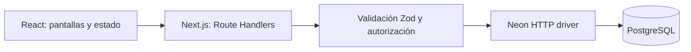

# PawsConnect

Aplicación full stack para reunir mascotas con sus familias en Costa Rica. Permite publicar reportes geolocalizados, encontrar posibles coincidencias y colaborar con pistas públicas.

**[Aplicación](https://paws-connect-prototype.vercel.app/)** · **[Demostración de solo lectura](https://paws-connect-prototype.vercel.app/?demo=1)**

## Funcionalidades

- Registro e inicio de sesión con correo y contraseña, sesiones persistentes y cierre de sesión.
- Crear, editar, eliminar y resolver reportes de mascotas perdidas, encontradas o en adopción.
- Fotos comprimidas antes de enviarlas, ubicación elegida en el mapa y geolocalización opcional.
- Mapa con filtros por especie, estado, tamaño, color, texto y radio de distancia.
- Comunidad con publicaciones vinculadas a reportes y reacciones únicas por usuario.
- Mensajes **públicos por reporte**, actualizados cada 15 segundos. El autor recibe notificaciones persistentes.
- Registro privado de mascotas y edición de perfil.
- Coincidencias calculadas por especie, raza, color, tamaño y distancia. El resultado explica sus factores; no se presenta como IA visual ni como probabilidad de identidad.
- Enlaces compartibles y navegación con historial del navegador.
- Diseño adaptable, formularios con estados de carga/error y soporte para movimiento reducido.
- Modo de demostración separado: los datos ficticios están identificados y no se guardan en Neon.

## Tecnologías

Next.js 16 · React 19 · TypeScript estricto · Tailwind CSS 4 · Radix UI · Leaflet/OpenStreetMap · PostgreSQL en Neon · Zod · Node.js `crypto` · Vercel.

## Arquitectura



El navegador llama a `/api/state`, `/api/auth`, `/api/actions` y `/api/messages`. La conexión a Neon existe únicamente en módulos del servidor. Las mutaciones esperan confirmación del servidor; un error no muestra un éxito ficticio.

La propiedad de cada reporte y mascota se comprueba en las consultas SQL. El perfil público no expone correos de las cuentas ni hashes. Los contadores se calculan en el servidor. La creación de un reporte y su publicación comunitaria es atómica.

### Modelo de datos

| Tabla             | Responsabilidad                                   |
| ----------------- | ------------------------------------------------- |
| `app_users`       | Identidad, hash de contraseña y perfil            |
| `sessions`        | Hashes de tokens opacos con vencimiento           |
| `reports`         | Reportes públicos y estado de resolución          |
| `registered_pets` | Mascotas privadas de cada usuario                 |
| `posts`           | Una publicación por reporte                       |
| `likes`           | Reacción única por usuario y publicación          |
| `messages`        | Pistas públicas vinculadas al reporte             |
| `notifications`   | Avisos privados al autor del reporte              |
| `rate_limits`     | Límites compartidos entre instancias del servidor |

Las claves foráneas mantienen la integridad y eliminan registros dependientes al borrar su recurso principal. Los índices cubren búsquedas por propietario, reporte y fecha.

## Ejecutar localmente

Requiere Node.js 22 o posterior.

```bash
npm ci
```

1. Crea un proyecto PostgreSQL en Neon o vincúlalo desde **Vercel → Storage → Neon**.
2. Copia `.env.example` a `.env.local` y configura `DATABASE_URL` con la conexión que entrega Neon. Conserva TLS (`sslmode=require`).
3. Ejecuta `npm run db:migrate`. La migración crea tablas e índices de forma idempotente en una transacción.
4. Ejecuta `npm run dev` y abre la dirección local indicada por Next.js.

Sin `DATABASE_URL`, la aplicación ofrece una demostración de solo lectura. Con una base configurada y vacía, comienza sin reportes ficticios. La demostración también está disponible en `/?demo=1`.

**Nunca publiques `.env.local` ni uses un prefijo `NEXT_PUBLIC_` para la conexión de la base de datos.**

## Comprobaciones

```bash
npm run typecheck
npm test
npm run build
npm audit --audit-level=high
```

Las pruebas unitarias cubren validación de entradas, eliminación de campos controlados por el servidor, imágenes no permitidas y el cálculo de coincidencias.

Para comprobar los flujos completos de servidor, inicia la aplicación local conectada a una **base de desarrollo** y ejecuta:

```bash
npm run test:integration
```

La prueba verifica autenticación, persistencia en Neon, aislamiento entre usuarios, reacciones idempotentes, mensajes, notificaciones y cierre de sesión. Crea cuentas aleatorias `@example.invalid` y elimina exclusivamente sus propios datos al terminar. Se niega a apuntar a una URL remota. `TEST_BASE_URL` permite cambiar el puerto local.

GitHub Actions ejecuta instalación reproducible, TypeScript, pruebas unitarias, compilación y auditoría de dependencias. Las pruebas con Neon se ejecutan aparte para no exponer credenciales en CI.

## Despliegue en Vercel

1. Importa este repositorio y elige el framework Next.js.
2. Vincula Neon al proyecto. La integración configura `DATABASE_URL` como variable del servidor.
3. Ejecuta la migración contra la base elegida antes del primer despliegue.
4. Publica la rama de producción. Usa bases o ramas de Neon separadas para los entornos de vista previa.

La base no se modifica durante `next build`. La integración de Neon puede crear una rama aislada por despliegue de vista previa.

## Decisiones y alcance

- Contraseñas derivadas con `scrypt` y sal aleatoria; tokens aleatorios de 256 bits almacenados como SHA-256. Cookie `HttpOnly`, `SameSite=Lax`, `Secure` en producción y vencimiento de siete días.
- Mutaciones limitadas al mismo origen, consultas parametrizadas, validación del servidor y límites de peticiones persistidos en PostgreSQL.
- Los reportes son públicos: el formulario solicita un teléfono que aparecerá en su ficha. Las mascotas registradas son privadas. Los mensajes se identifican como públicos.
- El registro actual usa correo y contraseña. No incluye verificación de correo, recuperación por correo, OAuth ni mensajería privada; la interfaz no ofrece esas funciones como si existieran.
- Las fotos se reducen a un máximo de 900 píxeles y 500 KB de representación antes de guardarse en PostgreSQL. Es una decisión para el alcance de portafolio; para más volumen conviene migrar fotos a almacenamiento de objetos y añadir paginación. El listado actual muestra hasta 200 reportes recientes y 100 publicaciones/mensajes por consulta.
- Los selectores territoriales dan una referencia aproximada. Se puede ajustar el punto directamente en el mapa.
- La demo utiliza fotografías de Unsplash y registros ficticios. Los mapas usan OpenStreetMap y mantienen su atribución.

## Para el CV

**PawsConnect — Aplicación full stack de colaboración comunitaria**

Desarrollo de una plataforma con Next.js, React, TypeScript y PostgreSQL en Neon para gestionar reportes geolocalizados de mascotas. Implementación de autenticación con sesiones seguras, autorización por propietario, operaciones transaccionales, filtros geoespaciales, coincidencias explicables y pruebas automatizadas, con despliegue en Vercel.
